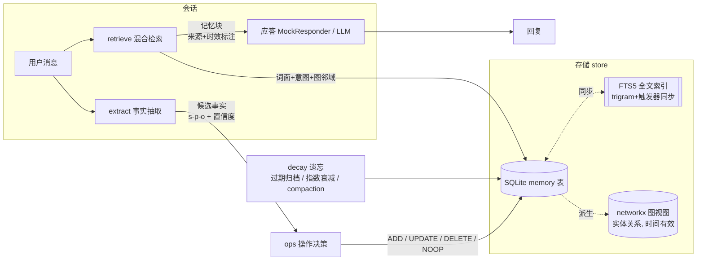

# memomind —— Agent 长期记忆系统（求职记忆助理）

> 自研的 Agent 长期记忆全链路：**事实抽取 → 操作决策 → 存储 → 混合检索 → 遗忘**，
> 对标 Mem0 / Letta / Zep 的范式，不依赖 mem0 / letta / langchain，核心约 1500 行 Python。
> 业务场景定为"求职记忆助理"：跨会话记住投递进展、面试反馈、简历偏好，并做记忆合并 /
> 冲突消解 / 过期衰减。

本项目是我准备 2027 寒假 Agent 应用开发实习的第三个作品（同工作区还有 policy-compass、askbi）。
选题直接对齐 2026 年 9-10 月的面试真题：字节一面"Agent 的记忆机制"、字节番茄"为何三层记忆？
长期记忆怎么保证正确？"、小红书"长/短期记忆底层实现"、腾讯 JD 原文"记忆的抽取、存储、检索、
更新、遗忘全链路、跨会话一致性"——这个仓库就是这些问题的可运行答案。

---

## 一、架构



一次对话的完整管线（`chat.py::MemoChat.handle`）：

```
retrieve(检索+touch) → render(注入块) → respond(应答) → extract(抽取)
    → ops.decide(对照 active 快照决策) → store.apply_ops(落库)
```

**关键认知：记忆不在对话里，在对话外。** 聊天历史是短期上下文；长期记忆是
"从对话中蒸馏出的、带时间有效性与置信度的三元组断言库"，跨会话共享。

## 二、快速开始

```bash
# Windows + Git Bash（pip 必须加官方源索引，默认镜像可能 403）
python -m venv .venv
.venv/Scripts/python -m pip install -i https://pypi.org/simple/ -r requirements.txt

# 测试（118 个，全 mock 无网络）
.venv/Scripts/python -m pytest -q

# 评测 v1（20 个脚本化跨会话场景，输出分维度正确率）
.venv/Scripts/python -m evals.run_evals
.venv/Scripts/python -m evals.run_evals --verbose --json

# 评测 v2（100 条跨会话用例，5 层对抗视角，mock 应 100/100）
.venv/Scripts/python evals/run_eval_set100.py

# 面试演示（3 个确定性会话，打印每步记忆轨迹）
.venv/Scripts/python scripts/demo.py

# API + 记忆浏览器（http://127.0.0.1:8770/）
.venv/Scripts/python -m uvicorn memomind.api:create_app --factory --port 8770
```

接真模型（可选，DashScope 兼容模式 / 任何 OpenAI 兼容端点）：

```bash
export MEMOMIND_LLM_BASE_URL="https://dashscope.aliyuncs.com/compatible-mode/v1"
export MEMOMIND_LLM_API_KEY="sk-..."       # 缺 key 抛 MissingLLMConfigError，信息里写明怎么配
export MEMOMIND_LLM_MODEL="qwen-plus"
```

设了 key，API 层自动切换为 LLM 抽取 + LLM 决策 + LLM 应答；不设则全确定性 mock。
LLM 抽取输出经 `memomind/normalize.py` 谓词映射层归一成规范谓词
（真模型对比 0/20→19/20 的修复，见 `evals/eval_set100_report.md`）。

## 三、目录结构

```
memomind/
├── memomind/                 # 包
│   ├── schema.py             # 数据模型：MemoryRecord / ExtractedFact / MemoryOp
│   ├── store.py              # SQLite 存储 + FTS5 索引 + networkx 图视图
│   ├── extract.py            # 事实抽取：RuleExtractor（确定性）+ OpenAICompatibleExtractor
│   ├── normalize.py          # 谓词映射层：LLM 自由谓词/实体 -> 规范词典（确定性后处理）
│   ├── ops.py                # ★ 操作决策：ADD/UPDATE/DELETE/NOOP 决策矩阵 + 冲突消解
│   ├── retrieve.py           # 混合检索：FTS5 词面 + 意图映射 + 图邻域 + 时间衰减排序
│   ├── decay.py              # 遗忘：过期归档 / 指数衰减 / compaction
│   ├── chat.py               # 主循环：retrieve→注入→应答→extract→ops→store
│   ├── llm.py                # OpenAI 兼容客户端（httpx）+ 确定性 MockResponder
│   ├── api.py                # FastAPI：/chat /memories /forget /graph /maintenance
│   └── static/index.html     # 单文件记忆浏览器（记忆列表 + 实体子图，无外部依赖）
├── evals/
│   ├── scenarios.py          # 20 个脚本化跨会话场景（5 维度 × 4）
│   └── run_evals.py          # 评测执行器：分维度正确率 + --json
├── tests/                    # 118 个 pytest（store/extract/normalize/ops/retrieve/decay/chat/api）
├── scripts/demo.py           # 3 个确定性演示会话
├── docs/TAKEOVER.md          # 接手指南：白板重写清单 / 必做实验 / 原创扩展
├── pyproject.toml
└── requirements.txt
```

## 四、核心设计

### 4.1 记忆即"带时间有效性的三元组断言"（schema.py / store.py）

一条记忆 = `(subject, predicate, object)` + `confidence` + `[valid_from, valid_to)` +
`status ∈ {active, archived, superseded}` + 溯源字段（`source_session` / `created_at` /
`last_accessed`）。三种状态的语义：

| 状态 | 含义 | 参与检索 | 参与冲突判定 |
|---|---|---|---|
| active | 当前成立 | ✓ | ✓ |
| superseded | 被新事实替代/被撤销（逻辑删除，审计可查） | ✗ | ✗ |
| archived | 过期或衰减遗忘（或手动 forget） | ✗ | ✗ |

存储选 SQLite 单表 + **FTS5 external-content 虚拟表**（trigram 分词，触发器同步，
中文子串可召回，2 字词由 LIKE 兜底）；图视图是**派生视图**——每次查询从 active 且
时间有效的记忆即时构建 networkx.MultiDiGraph，不落盘。记忆是事实，图是事实的一种读法。

### 4.2 ★ 操作决策：本项目的头号模块（ops.py）

抽取器只负责"说出事实"，**入库前必须过决策器**：对照现有 active 记忆，
为每条候选事实裁决 ADD / UPDATE / DELETE / NOOP。这是 Mem0 论文里
`ADD/UPDATE/DELETE/NOOP` 范式的自研实现，也是"长期记忆怎么保证正确"的第一道防线。

**决策矩阵（RuleOpsDecider，确定性）：**

| # | 条件 | 动作 | 说明 |
|---|---|---|---|
| A0 | 新事实置信度 < 0.30 | `NOOP` | 低置信垃圾直接丢弃 |
| C1 | 撤销型事实（"取消阿里的申请"）命中同实体的投递/状态记忆 | `DELETE` ×n + `ADD` | 旧记忆置 superseded；撤销本身留档审计 |
| B1 | 冲突键命中且 (s,p,o) 完全相同、新置信度更高 | `UPDATE(strengthen)` | 重复提及→合并强化置信度（+0.05，cap 0.99），**不新增重复记忆** |
| B2 | 冲突键命中且 (s,p,o) 完全相同、置信度不更高 | `NOOP` | 防重复写入 |
| D1 | 冲突键命中但 object 不同、谓词可冲突 | `UPDATE(supersede)` | **矛盾→新事实生效**；旧事实置 superseded 并封口 valid_to |
| D2 | 冲突键命中但 object 不同、谓词多值 | `ADD` | 多值谓词并存（投多家公司都是真的） |
| E1 | 冲突键无命中 | `ADD` | 全新事实 |

**"谁跟谁可能矛盾"由冲突键（conflict key）声明**，按谓词分三档：

- `functional`——单值属性，键 = `(subject, predicate)`：name / target_role / works_at / prefers_city。
  "想投后端" → "改投 Agent 岗"必然矛盾，走 D1 替代。
- `entity`——状态类按实体分组，键 = `(subject, predicate, entity(object))`：
  application_status 的 object 是 `"字节跳动:submitted"`，实体 = 字节跳动。
  "已投字节" vs "字节流程结束" 在同一实体上矛盾，状态被替代；**而
  `applied_to 字节跳动`（投递历史）键不同，保留**——历史为真，状态更新，两不误。
- `per_object`——多值谓词，键含 object，永不冲突：applied_to / prefers / uses。
  未知谓词默认 per_object（宁可并存，不可误杀）。

决策器在**本地模拟状态**上顺序处理一批事实，所以同一轮里"投了X"再"X流程结束"
也能正确消解，不依赖数据库即时落库。`LLMOpsDecider` 把候选事实+现有记忆交给
模型裁决，**任何异常都回退规则决策器**——决策层永远不能挂掉。

### 4.3 混合检索（retrieve.py）

```
base   = 词面命中数 × 2.0 + 意图命中 × 4.0 + 图邻域 × 3.0
score  = base × confidence × 0.5^(idle_days / 30)      # 指数时间衰减
```

三路召回：① FTS5 词面（trigram，中文二元词兜底）；② **意图映射**——
"我叫什么名字？"和 `user name 李雷` 没有词面交集，用"疑问意图→谓词"映射表补语义缺口，
这是无 embedding 系统里对语义检索的最低成本近似；③ 图邻域——query 命中实体的一跳
邻居记忆一并入候选（提到字节时，字节的状态记忆一起出来）。排序后按 `top_k` 和
`max_chars` 字符预算截断，渲染成带**来源与时效标注**的注入块。命中即 `touch` 刷新
`last_accessed`——"被想起"会重置遗忘时钟。

### 4.4 遗忘（decay.py）——三种遗忘严格分层

1. **过期归档**：`valid_to` 已过 → archived（记忆自己声明了有效期，如实习 3 个月）。
2. **衰减归档**：`confidence × 0.5^(idle_days/30) < 0.15` → archived。
   常用记忆因 touch 天然抗遗忘；参数（半衰期/阈值）全部可配。
3. **compaction**：superseded / archived 超保留期（默认 30/90 天）才**物理删除**。
   逻辑遗忘（决策层/归档）与物理遗忘（GC）分层，审计与"反悔"才有空间。

### 4.5 跨会话一致性怎么保证

- 记忆本体与 session 解耦：session_id 只进 `source_session` 溯源，检索跨会话共享；
- 每次写都过决策器：同一事实重复陈述 → NOOP/强化，不会出现"记忆漂移"（同一偏好
  被存成 5 条置信度各异的记忆）；
- 矛盾不叠加：functional/entity 谓词永远只有一条 active 断言（旧的同键事实被 superseded），
  图和检索在任何时刻读到的都是自洽快照；
- 时间轴可回放：superseded 记忆保留 valid_to 封口，"我 8 月时投了什么"这类回溯问题
  有审计数据可依。

## 五、评测（真实数字，命令可复现）

20 个脚本化跨会话场景（5 维度 × 4 场景），全程 RuleExtractor + RuleOpsDecider +
MockResponder、固定起始时钟，无网络无随机。**注意：这是确定性 mock 模式的数字**，
衡量的是决策矩阵/检索/遗忘逻辑的正确性；接真模型用同一命令复现
（`evals/run_evals.py::build_pipeline` 里换 provider 即可）。

```
$ python -m evals.run_evals
```

| 维度 | 场景数 | 通过 | 正确率 | 覆盖点 |
|---|---|---|---|---|
| 记忆保持 | 4 | 4 | **100%** | 跨 1-3 个会话后仍能召回姓名/公司/技能/目标岗位 |
| 偏好更新 | 4 | 4 | **100%** | 改投岗位/换城市（旧值 superseded）；重复提及强化置信度 0.85→0.93；新偏好检索第一 |
| 冲突消解 | 4 | 4 | **100%** | 已投→流程结束；面试→挂了；换雇主；取消申请（DELETE 链） |
| 时效遗忘 | 4 | 4 | **100%** | 120 天未访问衰减归档；valid_to 到期归档；常访问记忆 80 天存活；compaction 物理清理 |
| 冷启动 | 4 | 4 | **100%** | 空库寒暄零垃圾记忆；首轮全 ADD；同会话即时召回；重复陈述不落重 |
| **整体** | **20** | **20** | **100%** | |

```text
$ python -m pytest -q
118 passed in 2.60s
```

测试分布：normalize 29（谓词词典/亚词兜底/极性修正/伴随补全/实体归一）、store 12
（往返/FTS 同步/图时间有效性/持久化）、ops 14（决策矩阵全分支 + 同轮自洽 +
LLM 决策器回退）、extract 11（规则确定性 + OpenAI 兼容 MockTransport + 缺 key
异常）、transfer 11、retrieve 8（排序/衰减/意图/图扩展/预算）、decay 8、
embedding 7、chat 6、api 6、schema 6。全 mock 无网络。

## 六、与 Mem0 / Letta / Zep 的对比

| | **memomind（本项目）** | Mem0 | Letta（原 MemGPT） | Zep（Graphiti） |
|---|---|---|---|---|
| 记忆模型 | 三元组断言 + 时间有效性 + 置信度 | 事实型文本记忆 + 元数据 | 分层上下文（核心记忆/归档/召回），自编辑 | 时序知识图谱（episode→semantic/community） |
| 写入决策 | 规则决策矩阵（可全量测试）+ LLM 版 | LLM 决策 ADD/UPDATE/DELETE/NOOP | agent 自主调用记忆工具自编辑 | 实体/边抽取 + 边失效（t_invalid） |
| 冲突消解 | 冲突键三档策略，矛盾→supersede+valid_to 封口 | LLM 判断矛盾后改写 | 无显式冲突键，靠 agent 编辑 | 时间边模型，新边失效旧边 |
| 检索 | FTS5 词面 + 意图映射 + 图邻域 + 时间衰减 | 向量 + 关键词混合 | 关键词 + 嵌入检索 | 图遍历 + 余弦 + BM25 混合 |
| 遗忘 | 三层：过期/衰减归档 + compaction GC | 弱（靠决策 DELETE） | 归档分层 | 边级时间有效性 |
| 依赖 | sqlite3+networkx+fastapi，6 个直接依赖 | 向量库 + LLM 必选 | 较重 | Neo4j / FalkorDB 必选 |
| 可测试性 | 全链路确定性 mock，118 测试 + 100 评测 | 依赖真模型，评测成本高 | 同左 | 同左 |

**取舍说明**：生产级系统里语义检索应该用 embedding（Mem0/Zep 路线），本项目刻意用
"词面+意图映射+图邻域"把语义缺口补到"评测可断言"的程度，换来全链路确定性——
这是作品集项目最值钱的取舍：**先让决策与遗忘逻辑可证明正确，再谈语义质量**。
Zep 的时间边模型与我的 valid_from/valid_to 同构，但我的冲突键策略更显式、更可测。

## 七、面试叙事（作品化回答）

**Q1（字节一面）：Agent 的记忆机制是怎么设计的？**
答：我会把记忆切成两层：会话内是模型上下文里的短期记忆，会话外是持久化的长期记忆。
我做 memomind 时把长期记忆定为"从对话蒸馏出的三元组断言 + 置信度 + 时间有效性 +
生命周期状态"，而不是存对话原文——原文是日志，断言才是记忆。写入前有一个操作决策层，
每条候选事实对照现有记忆裁决 ADD/UPDATE/DELETE/NOOP（这层借鉴 Mem0 的范式但用规则
实现，可以全量单测）；读取时用混合检索（FTS5 词面 + 意图映射 + 图邻域，按置信度和
时间衰减加权排序）拼出带来源标注的注入块；后台有遗忘层做过期归档和指数衰减。
一句话总结：抽取、决策、存储、检索、遗忘五个环节各司其职，记忆库才不会越用越脏。

**Q2（字节番茄）：为什么要分层/三层记忆？长期记忆怎么保证正确？**
答：分层是因为不同记忆的生命周期和用途完全不同：工作记忆（当前轮上下文）要快进快出；
情景记忆（会话历史）用于回溯；语义/事实记忆（画像、偏好、状态）要长期一致。混在一层
会导致两个灾难：要么把一次性细节固化成永久记忆，要么让关键事实被对话噪音冲掉。
正确性上我做了四道防线：① 抽取置信度阈值，低置信直接丢弃；② 决策矩阵——完全重复
NOOP 防重复、矛盾 supersede 防双真、多值并存防误杀，冲突键按谓词分三档声明"谁跟谁
可能矛盾"；③ 时间有效性，每条断言带 valid_from/valid_to，过期自动失效；④ 检索端
置信度×时间衰减加权，错旧记忆自然沉底。我的评测集里"偏好更新"和"冲突消解"两个维度
各 4 个场景 100% 通过，就是这道防线的回归测试。

**Q3（小红书）：长/短期记忆的底层实现？什么时候删、怎么删？**
答：短期记忆就是对话窗口/context 管理（我的 chat 循环里体现为"检索注入块"，字符预算
上限可配）；长期记忆底层是 SQLite 单表存三元组，FTS5 做词面索引，networkx 内存图做
关系视图。删除分三种语义，绝不混用：**被替代**（矛盾→旧事实 superseded，valid_to
封口，审计可查）、**过期/衰减**（valid_to 到期，或 confidence×0.5^(闲置天数/半衰期)
低于阈值 → archived，"被想起"会刷新时钟所以常用记忆天然抗遗忘）、**物理清理**
（superseded/archived 超保留期由 compaction 删除）。逻辑删除与物理删除分层，是垃圾
回收里"标记"与"清扫"的思路——记忆系统需要"反悔"和"回溯"的能力。

**Q4（腾讯 JD：Mem0 与 RAG 的区别）**
答：RAG 是"检索增强"：查询时从外部文档库找相关片段拼进上下文，**知识只读**、无状态，
适合事实问答。Mem0 这类记忆系统是"有状态的记忆"：持续从交互中**写入**（还带
ADD/UPDATE/DELETE 决策）、会**演化**（偏好更新、状态流转、过期衰减），查询时检索的
是"关于这个用户的断言"而非文档。我的实现里能具体指出三点差异：① 写路径——RAG 只有
ingestion，我有抽取+决策矩阵；② 一致性——RAG 文档可并存矛盾版本，我的记忆同一冲突键
只允许一条 active；③ 时效——RAG 片段没有时间有效性，我的记忆带 valid 窗口和衰减。
它们是互补的：我的检索层接一个向量后端，就同时具备 RAG 的语义召回能力。

## 八、API 一览

| 方法 | 路径 | 说明 |
|---|---|---|
| POST | `/chat` | `{session_id, message}` → 回复 + 命中记忆 + 抽取事实 + 决策列表 |
| GET | `/memories` | `status`/`subject`/`q` 过滤记忆列表 |
| POST | `/forget` | `{memory_id}` 手动遗忘（active → archived） |
| GET | `/graph/{entity}` | 实体一跳记忆子图 JSON（nodes/edges，带谓词与置信度） |
| POST | `/maintenance` | 手动触发遗忘 + compaction（运维/演示用） |
| GET | `/` | 单文件记忆浏览器（对话、记忆列表、实体子图 SVG，无外部依赖） |

## 九、已知边界（诚实声明）

- 规则抽取器限定求职域中文口语，正则规则表是显式知识，换个领域要换词表
  （接口不变，换 OpenAICompatibleExtractor 即可）；
- 检索无 embedding，意图映射表覆盖有限谓词；这是刻意取舍，见第六节；
- SQLite 单写者，未做并发；多用户需要按 user 分库或加 user_id 列；
- 评测是封闭脚本场景，衡量逻辑正确性而非语义召回质量；
- conf 强化策略（+0.05）与衰减参数（半衰期 30 天）是经验值，TAKEOVER 里列了标定实验。

详细接手指南见 [docs/TAKEOVER.md](docs/TAKEOVER.md)。

## 记忆可移植层 + 图查询 DSL（原创）

全字段 JSONL 导出/幂等导入（同 id 或同 active 三元组自动去重，换库零丢失——回答"记忆锁死在 SQLite 怎么办"）+ 图查询 DSL（`李雷 -target_role-> *`、`* -applied_to-> 字节跳动`、两跳路径）：

```python
from memomind.transfer import export_memories, import_memories, graph_query
export_memories(store, "dump.jsonl"); import_memories(store2, "dump.jsonl")
graph_query(store, "user -target_role-> *")
```

9 项测试（全量 79 绿）；"N 个 -> = N 跳"的语义修正记录见 `docs/transfer_adr.md`。

## 真模型抽取对比（deepseek-v4-flash，2026-10-28）

7 条真实口语输入逐条对比（real_model_report.md）：LLM 抽出规则抓不到的语义
（`failed_interview_at`"没过一面"、`prefers_location`），但把"不想投阿里了"错抽成
`applied_to`（撤回语义是 LLM 抽取的典型盲区，规则版正确）——**规则打底 + LLM 增强混合
架构的实证**，LLMOpsDecider 异常回退规则版的机制正是为此设计。

## Embedding 语义重排（A13，迁移路径第一步）

`embedding.py`：Mock（确定性 4-gram）/ OpenAI 兼容双 provider + Retriever 可选 `embedder`——三路召回候选用查询-记忆余弦相似度加权重排（无 embedder 行为逐字不变）。真额度开通即插即用，预计算向量表列为生产前提。7 项测试（全量 88 绿）；取舍见 `docs/adr.md` ADR-5 增补。
