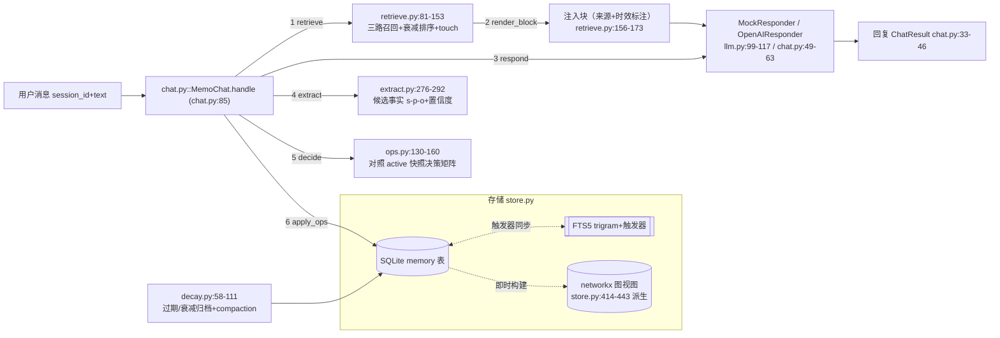
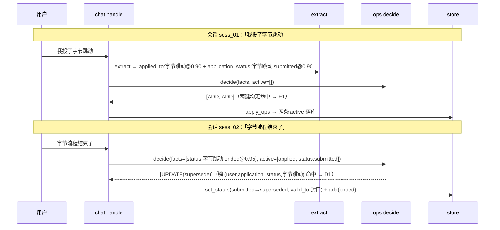

# memomind 项目书

> 本文是项目的完整技术叙事与内化手册：定位 → 技术栈 → JD 映射 → 全流程走读 → 代码内化路线 → 面试讲法 → 边界与演进。
> 配套阅读：[README.md](../README.md)（架构与评测数字）、[TAKEOVER.md](TAKEOVER.md)（接手指南：白板重写清单 / 必做实验 / 原创扩展）。
> 本文所有 `文件:行号` 均对应仓库当前版本源码，写完后已逐一回源码核对；所有数字（79 测试 / 20 场景 / 各参数）可跑命令复现：
> `python -m pytest -q` → 70 passed；`python -m evals.run_evals` → 整体 20/20 100%。

---

## 0. 一页定位

### 0.1 是什么（一句话）

memomind 是一个自研的 Agent 长期记忆系统：从对话里蒸馏**"带时间有效性与置信度的三元组断言"**，经操作决策矩阵消解冲突后入库，用"词面 + 意图 + 图邻域"三路混合检索注入回对话，再由三层遗忘机制管理生命周期。业务场景定为"求职记忆助理"——跨会话记住投递进展、面试反馈、简历偏好，并做记忆合并 / 冲突消解 / 过期衰减。不依赖 mem0 / letta / langchain，约 1500 行 Python、6 个直接依赖；70 项 pytest 全绿，20 个脚本化跨会话场景五维 100%。

一句话心智模型（README §一，也是全项目的纲领）：**记忆不在对话里，在对话外**——聊天历史是短期上下文；长期记忆是"从对话中蒸馏出的、带时间有效性与置信度的三元组断言库"，跨会话共享。

### 0.1.1 三个"不做什么"（负向定位同样是设计）

| 不做 | 为什么不做 | 替代方案 |
|---|---|---|
| 不存对话原文 | 原文是日志不是记忆——无法做冲突消解、无法声明有效期、检索噪声大 | 只存形式化断言，原文留在会话侧 |
| 不依赖 mem0/langchain/向量库 | "为什么不用现成框架"是 2026 面试必答题（mianjing §1 差异化三板斧）；依赖框架的评测成本高、行为不可复现 | 自研最小内核 + OpenAI 兼容接口留切换件 |
| 不在评测里引入随机性 | 评测数字要"谁跑都是这个数"，才能当回归防线用 | 确定性 mock + 固定时钟 + 脚本化场景 |

### 0.2 解决什么面试必答题

| 题目（来源） | 本项目的回答入口 |
|---|---|
| 字节一面原题"Agent 的记忆机制"（`interview/mianjing/00_检索结论_2026-10.md` 第 13 行，2026-08~10 面试最高频题） | 五环节管线：抽取→决策→存储→检索→遗忘，每环节一个模块（§3.2） |
| 腾讯记忆岗 JD 原文"记忆的抽取、存储、检索、更新、遗忘全链路、跨会话一致性"（README 引言；`interview/resume/01_作品集叙事与简历布局.md:43` 引作"抽取/存储/检索/更新/遗忘"） | 五个 JD 名词各对应一个模块，逐条映射见 §2 |
| 字节番茄一面 09-19"为何三层记忆？长期记忆怎么保证正确？"（mianjing 第 49 行） | 分层叙事 + 四道正确性防线（§5.3 Q2 前置、README §四） |
| 小红书一面 08-19"长/短期记忆底层实现"（mianjing 第 51 行） | 注入块 vs SQLite/FTS5/图（§2 倒数第二行） |
| "记忆何时删、怎么删"（`interview/mock_interviews/04_新项目组合场.md:10` 预判的必答题） | 三种删除语义严格分层（§3.3 末尾） |

这个仓库就是这些问题的**可运行答案**：每道题都能从"口述叙事"下降到"模块 → 函数 → 行号 → 评测数字"。

### 0.3 与两个"前辈项目"的组合叙事

同工作区作品链是能力递进的三段式（口径对齐 `interview/resume/01_作品集叙事与简历布局.md` §1 的五项目能力栈）：

1. **PolicyCompass**（Agentic RAG，检索增强）：回答"知识从外部怎么取"——混合检索、自纠错、忠实度校验、拒答。但 RAG 的知识是**只读**的静态文档，检索一万次世界不变。
2. **AskBI**（多 Agent ChatBI，工具编排）：回答"多 Agent 怎么协作、数字怎么保真"——口径治理、沙箱执行、数值质检。但任务结束状态即丢失，下次对话从零开始。
3. **memomind**（本项目，认知记忆）：回答"系统怎么**记住这个用户**并随时间演化"——补上前两个项目都没有的"有状态"一环：写入要过决策、记忆会更新 / 冲突 / 过期，查询时检索的是"关于这个用户的断言"而非文档。

面试开场串场词（可直接用）："前两个项目解决了'会检索、会编排'，memomind 解决'记得住、记得对、记得久'——RAG 管世界知识，记忆管'这个用户是谁'，三层合起来才是完整的 Agent 应用层。"再进一步（`interview/mock_interviews/04_新项目组合场.md:10` 的咬合逻辑）：同工作区 miniagent 可把 memomind 当记忆层接入，agenteval 可评带记忆 agent 的任务成功率——"底层引擎 + 质量设施 + 认知记忆"，不是孤立 demo。

### 0.4 简历一句话版

> 自研 Agent 长期记忆系统（不依赖 mem0/langchain，约 1500 行 Python）：三元组断言 + 7 分支操作决策矩阵（Mem0 范式）+ SQLite/FTS5/时序知识图 + 三路混合检索 + 三层遗忘；70 项 pytest 全绿，20 个跨会话场景（记忆保持/偏好更新/冲突消解/时效遗忘/冷启动）五维 100%。

---

## 1. 技术栈全景

> 口径：每层给"选型 | 为什么 | 被否掉的替代方案及原因"，并诚实标注哪些是**额度限制下的显式取舍**（无 embedding API 配额），哪些是当前规模内的合理最优。总览表之后每层有一段展开。

| 层 | 选型 | 为什么选它 | 被否掉的替代方案及原因 |
|---|---|---|---|
| 存储 | SQLite 单表 `memory` + FTS5 external-content 虚拟表（trigram 分词，触发器同步，`store.py:142-204`） | 零部署单文件；FTS5 全文索引随写自动同步（三个触发器 `store.py:178-203`），中文子串可召回；`db_path` 参数让测试用 `:memory:`、生产用文件，同一套代码 | **向量库（chroma/faiss）**：需要 embedding 模型或 API——无配额，且向量相似度非确定、评测不可断言；**Postgres+pgvector**：部署重，单用户演示场景用不上；生产多租户时是自然迁移路径 |
| 图 | networkx 内存派生视图（`store.py:414-443`），每次查询从 active 且时间有效的记忆即时构建 MultiDiGraph，**不落盘** | "记忆是事实，图是事实的一种读法"——图作为派生物永不与主表不一致；零运维 | **Neo4j/FalkorDB**：独立服务运维成本远超项目规模（Zep 路线必选重依赖的原因）；**纯 SQL 自关联表**：一跳邻域要写递归 CTE，易错且难扩多跳。诚实代价：图重建 O(active 记忆数)，大库需换增量维护（§6） |
| 抽取 | 规则抽取器 RuleExtractor（正则规则表 + 实体别名归一化，`extract.py:220-268`）与 LLM 抽取器 OpenAICompatibleExtractor（`extract.py:309-365`）**双实现、同一接口**（`extract.py:93-100`） | 规则版确定性、零网络、可全量单测，是评测可复现的前提；LLM 版已实现并用 MockTransport 测过，接口不变即可切换 | **纯 LLM 抽取**：评测全依赖 key，失败模式不可复现；**embedding 方案做抽取**：方向错误——embedding 是检索技术，抽取要的是"口语→形式化断言"的结构化。**标注：规则先行是"无 LLM 额度"下的显式取舍，LLM 版是切换件而非重构** |
| 检索 | 三路召回：FTS5 词面 + 意图映射（`retrieve.py:34-43`）+ 图邻域（`retrieve.py:115-136`），按 `score = base × confidence × 0.5^(idle/30)` 排序（`retrieve.py:141-143`） | 词面管"字面命中"；意图映射管"问题与记忆零词面交集"（"我叫什么名字？" vs `user name 李雷`）；图邻域管"实体关联"。三路都确定性可测 | **纯向量检索**：同存储层理由——无配额 + 非确定；**纯 FTS5**：意图缺口补不上，"我叫什么名字"永远召不回姓名记忆（E01 会挂）。**标注：意图映射是无 embedding 配额下对语义检索的最低成本近似，映射表只覆盖 8 类谓词（`retrieve.py:34-43`），这是债不是终点** |
| 决策器 | 规则决策矩阵 RuleOpsDecider 为主（`ops.py:130-160`），LLMOpsDecider 为可选件（`ops.py:283-365`），LLM 异常回退规则（`ops.py:363-365`） | 决策是"长期记忆怎么保证正确"的第一道防线，必须可全量单测——7 分支矩阵每支都有测试；LLM 版保留升级空间但**决策层永不挂掉** | **纯 LLM 决策**：同一输入可能不同输出，评测不可断言；且 LLM 输出 UPDATE 不带 target_id 时仍要借规则定位（`ops.py:349-352`）——规则层是地基不是备胎 |
| 服务层 | FastAPI + 共享单连接（`check_same_thread=False`，`store.py:133-135`），工厂函数注入 store/retriever/decider（`api.py:87-101`） | 记忆库读多写少、单用户演示；依赖注入让测试传 `:memory:` 零改动 | **多写者/WAL 并发**：SQLite 单写者假设是刻意声明（TAKEOVER §4"别加并发写"），多用户是 §6 演进项；**每请求新连接**：无谓开销且丢事务边界 |
| 时钟 | 全链路可注入时钟（`store.py:126-130`、`tests/conftest.py:15-25` FakeClock） | 衰减/过期/保留期全是时间的函数——不注入时钟，"120 天归档"永远没法离线测 | **直接 `time.time()`**：测试与评测不可确定（TAKEOVER §4 明令新代码禁止直接调） |
| 质量 | 70 项 pytest（全 mock 无网络，<1s）+ 20 场景五维评测 + 3 个确定性演示（`scripts/demo.py`） | 断言对象是**系统状态与检索行为**（谁 active / 谁 superseded / 召回了什么），不是应答文本——换 responder 不破测试 | **依赖真模型做回归**：慢、贵、不稳定，正是 Mem0/Letta 类系统可测试性短板（README §六对比表） |

依赖面：6 个直接依赖（networkx / fastapi / uvicorn / httpx / pydantic / pytest，见 `pyproject.toml`），不依赖 openai SDK / langchain / mem0 / letta——LLM 访问是 117 行的 httpx 客户端（`llm.py`），可注入 `httpx.MockTransport` 离线测（`llm.py:56-79`），缺 key 抛带配置指引的 `MissingLLMConfigError`（`llm.py:47-52`）。

### 1.1 存储层展开：为什么 SQLite + FTS5 够、且是"对的"

- **单表即记忆本体**：12 列与 `MemoryRecord` 一一对应（`store.py:146-161`），status 有 CHECK 约束锁三态（`store.py:155-156`）——数据库层就挡住非法状态。
- **FTS5 external-content 模式**：虚拟表 `content='memory'`（`store.py:169-177`）不存正文只存索引，主表是唯一事实源；插入/更新/删除由三个触发器同步（`store.py:178-203`），写路径零额外同步代码。
- **tokenizer 双模式**：启动时探测 trigram 可用性（`store.py:86-96`，需 SQLite >= 3.34），不可用退回 unicode61 + 前缀查询——两种模式下检索接口行为一致。
- **2 字中文词的诚实处理**：trigram 分词下"字节"无 3-gram，FTS 召不回——由 LIKE 兜底补齐（`store.py:351-397` 的 `search_text`：FTS 命中 +2、LIKE 命中 +1，按 (命中数, id) 排序保证确定性）。这是"承认短板 + 机械兜底"的写法，不是"假装没有这个问题"。

### 1.2 检索层展开：三路召回各自解决什么缺陷

| 路 | 解决的缺陷 | 实现 | 权重 |
|---|---|---|---|
| FTS5 词面 | 字面命中（"字节"→字节相关记忆） | `store.search_text`，FTS 为主 LIKE 兜底（`store.py:351-397`） | w_fts=2.0（`retrieve.py:52`） |
| 意图映射 | 问题与记忆**零词面交集**（"我叫什么名字？" vs `user name 李雷`） | 疑问意图→谓词映射表 8 条（`retrieve.py:34-43`），命中即捞同谓词全部 active 记忆（`retrieve.py:107-113`） | w_intent=4.0（`retrieve.py:53`） |
| 图邻域 | 实体关联记忆（提到字节时，字节的状态历史一起出来） | query 命中图节点（`retrieve.py:115-120`），一跳邻居的边入候选（`retrieve.py:121-136`） | w_graph=3.0（`retrieve.py:54`） |

排序与注入：`score = base × confidence × 0.5^(idle_days/30)`（`retrieve.py:141-143`），低于 `min_score=0.05` 丢弃、top_k=5 截断（`retrieve.py:144-149`），命中即 touch（`retrieve.py:148-153`）；渲染按 `max_chars=1200` 字符预算截断（`retrieve.py:156-173`）。**意图映射是"无 embedding 配额"下的显式取舍**——它把语义缺口补到"评测可断言"的程度，但 8 类谓词的覆盖面是明债（§6）。

### 1.3 决策器展开：为什么"规则为主、LLM 为可选件"

决策层的职责是"在写入前维持记忆库的自洽"，它必须**可全量单测**——这是与 Mem0（LLM 决策）最大的差异点，也是本项目可测试性优势的来源。混合形态的三个衔接点：

1. LLM 决策器解析失败 / 网络失败 / 输出非法动作 → 全部回退规则决策器（`ops.py:363-365`）；
2. LLM 说"UPDATE"但没指 target_id → 借规则版定位冲突对象，保证 UPDATE 语义完整（`ops.py:349-352`）；
3. 规则决策器在**本地模拟状态**上顺序处理一批事实（`ops.py:152-154`），同轮先投后撤自洽，不依赖数据库即时落库（`test_ops.py:98-106` 专项覆盖）。

---

## 2. JD 要求映射表

> JD/真题来源：`interview/mianjing/00_检索结论_2026-10.md`（下称 mianjing）——腾讯记忆岗专职 JD（README 引言与 `interview/resume/01_作品集叙事与简历布局.md:43` 均引其"抽取/存储/检索/更新/遗忘"原文，mianjing 第 67 行将"Agent 长期记忆"列为 3/30 列举项 + 腾讯专职岗）、字节番茄一面 09-19（mianjing 第 49 行）、字节一面"记忆机制"（mianjing 第 13 行）、小红书 08-19（mianjing 第 51 行）。每条给"面试怎么指到代码"的一句话。

| JD 原文 / 真题 | 本项目对应模块与关键代码 | 评测/测试数字 | 面试怎么指到代码（一句话） |
|---|---|---|---|
| 腾讯 JD：**抽取** | `extract.py::RuleExtractor.extract`（`extract.py:276-292`）：规则表 RULES 11 条（`extract.py:220-268`）、疑问句守门 `is_question`（`extract.py:61-63`）、实体归一化 `COMPANY_ALIASES`（`extract.py:40-56`）、置信度分档 `SKILL_CONF`（`extract.py:187`）；一次投递产出 applied_to + application_status 两条事实（`extract.py:118-130`） | test_extract 11 项全绿；E01-E04 记忆保持 4/4 | "抽取只负责说出事实、不判断新旧——规则表在 extract.py 的 RULES，每条规则一个 builder 产出带置信度的 ExtractedFact，疑问句在入口就被 is_question 拦掉" |
| 腾讯 JD：**存储** | `store.py::MemoryStore`：建表与 FTS5 虚拟表（`store.py:142-204`），写路径 `add/touch/set_status/hard_delete/apply_ops`（`store.py:210-313`） | test_store 11 项（往返/FTS 同步/持久化）；E18 冷启动首轮全 ADD（scenarios.py:444-450） | "存储是 SQLite 单表三元组，FTS5 用 external-content 模式加三个触发器和主表同步，写入侧 apply_ops 是唯一入口" |
| 腾讯 JD：**检索** | `retrieve.py::Retriever.retrieve`（`retrieve.py:81-153`）：三路召回加权（`retrieve.py:100-136`）、排序公式（`retrieve.py:141-143`）、预算截断与 touch（`retrieve.py:148-153`） | E02 跨会话召回、E08 新偏好检索第一；test_retrieve 8 项 | "排序是一行公式：词面×2.0 + 意图×4.0 + 图×3.0，乘置信度再乘半衰期 30 天的指数衰减，retrieve.py 141 到 143 行" |
| 腾讯 JD：**更新** | `ops.py::RuleOpsDecider`（`ops.py:130-160`）：重复提及强化 B1（`ops.py:183-198`，+0.05 cap 0.99）、矛盾替代 D1（`ops.py:202-217`）、多值并存 D2（`ops.py:204-206`） | E05 改投岗位旧值 superseded；E07 重复提及置信度 0.85→0.93 且只落一条；test_ops 14 项 | "更新不是一个动作是四种：ADD/UPDATE/DELETE/NOOP，冲突键按谓词分三档声明'谁跟谁可能矛盾'——矩阵在 ops.py 的 `_decide_one_inner`" |
| 腾讯 JD：**遗忘** | `decay.py`：过期归档（`decay.py:70-74`）、衰减归档（`decay.py:76-82`，阈值 0.15）、compaction 物理清理（`decay.py:87-111`，保留期 30/90 天） | E13 衰减归档、E14 过期归档、E15 常访问 80 天存活、E16 compaction，4/4；test_decay 8 项 | "遗忘分三种语义：过期、衰减、GC——decay.py 的 run_decay 管前两种，compact 只清超过保留期的 superseded/archived" |
| 腾讯 JD：**跨会话一致性** | 记忆与 session 解耦：session_id 只进 `source_session` 溯源（`schema.py:70`、`chat.py:104`）；同一冲突键永远只有一条 active（D1 supersede + 旧值封口 `store.py:259-277`） | E01 隔会话召回姓名；E09 状态被替代而投递历史保留 | "session_id 只是溯源字段，检索跨会话共享；一致性由决策器保证——同一冲突键不会出现两条 active" |
| 字节一面：**Agent 的记忆机制** | 五环节管线 `chat.py::MemoChat.handle`（`chat.py:85-114`）：retrieve→注入→应答→extract→decide→apply | 全链路 test_chat 6 项；E17 空库寒暄零垃圾记忆（scenarios.py:427-433） | "我把记忆切成'对话外'的三元组断言库而不是存对话原文，chat.py 的 handle 六步就是完整机制" |
| 字节番茄：**为何三层记忆？长期记忆怎么保证正确？** | 分层：短期=本轮注入块（`chat.py:88-91`，max_chars 预算 `retrieve.py:49`）、长期=断言库（`schema.py:51-72`）、图=派生读法（`store.py:414-443`）；正确性四道防线：置信度阈值 A0（`ops.py:166-170`）、决策矩阵（`ops.py:163-220`）、时间有效性（`schema.py:78-84`）、检索端衰减（`retrieve.py:138-146`） | 偏好更新 + 冲突消解两维 8/8——就是这道防线的回归测试 | "正确性是四道闸：低置信不入库、入库过决策矩阵、每条断言带 valid 窗口、检索端置信度×时间衰减让错旧记忆沉底" |
| 字节/小红书：**历史何时删、怎么删** | 三种删除语义严格分层：被替代→superseded + valid_to 封口（`ops.py:31-33` 时间线语义、`store.py:266-272` 封口实现）；过期/衰减→archived（`decay.py:70-82`）；超保留期→物理删除（`decay.py:99-109`） | E16：superseded 记忆超 30 天保留期被 compaction 物理清理（scenarios.py:406-414） | "删除分'被替代'（逻辑删，审计可查）、'过期/衰减'（归档）、'物理清理'（GC）三种，绝不混用——垃圾回收里标记与清扫的思路" |
| 小红书：**长/短期记忆底层实现** | 长期=SQLite 三元组 + FTS5 + networkx（§1 存储层）；短期=检索注入块渲染（`retrieve.py:156-173`，带来源/时效标注的行渲染在 `schema.py:110-117`） | E19 冷启动后同会话即时召回（scenarios.py:459-466） | "短期就是带字符预算的注入块，长期底层是 SQLite 单表存三元组，词面走 FTS5、关系走内存图" |
| 字节番茄：**为何 ES+BM25 混合检索、优化多少怎么测** | 三路召回各自补一个缺陷（§1.2 表）；"怎么测"= E08（排序正确性）+ TAKEOVER §2 实验 4 的 w_intent 敏感性消融 | E08 新增偏好后 top1 正确；w_intent 4.0→1.0 可观测排序被词面/图挤掉 | "我的三路召回就是 BM25+语义+图的最小本地版，每个都有独立评测场景，权重敏感性可以做消融" |

---

## 3. 全流程实现走读

### 3.1 端到端数据流

### 3.2 chat 全链路六步逐步走读（`chat.py::MemoChat.handle`，`chat.py:85-114`）

| 步 | 代码 | 输入 → 输出 | 失败时的行为 |
|---|---|---|---|
| 1. 检索 | `chat.py:89` → `retrieve.py:81-153` | query 文本 → `list[ScoredMemory]`（record + score + via 召回路径）；命中即 touch 刷新 `last_accessed`（`retrieve.py:148-153`） | 空库/无词面/全部低于 `min_score=0.05` → 返回空列表，**不报错**；query 无有效词（纯标点）→ `retrieve.py:86-87` 直接返回空 |
| 2. 注入块 | `chat.py:90` → `retrieve.py:156-173` | ScoredMemory 列表 → 带"来源+时效"标注的 markdown 块；按 `max_chars=1200` 预算从前往后保留（`retrieve.py:162-168`） | 无记忆 → 返回空串（`retrieve.py:171-172`），下游 responder 收到空块照常工作 |
| 3. 应答 | `chat.py:94` → `llm.py:99-117` / `chat.py:49-63` | (session, text, memory_block) → 回复文本；Mock 有记忆时复述前三条命中（`llm.py:113-116`），无记忆时"先记下来" | Mock 永不失败；真模型 httpx 异常会**上抛**（`llm.py:90-92`，无重试）——这是当前边界（§6），评测/测试全用 Mock 不受影响 |
| 4. 抽取 | `chat.py:97` → `extract.py:276-292` | 本轮文本 → `list[ExtractedFact]`（s-p-o + category + confidence + polarity） | 空串/疑问句 → 空（`extract.py:279-281`）；LLM 版 JSON 非法 → 记 warning 返回空（`extract.py:346-348`）；同一三元组轮内去重（`extract.py:283`、`extract.py:288-291`） |
| 5. 决策 | `chat.py:100-101` → `ops.py:130-160` | facts + `store.list_active(now)` 快照 → `list[MemoryOp]`；内部在**模拟状态**上顺序处理（`ops.py:152-154`），同轮先投后撤自洽 | facts 为空 → 空决策，LLM 版不发请求（`ops.py:307-308`）；LLM 版任何异常回退规则版（`ops.py:363-365`） |
| 6. 落库 | `chat.py:104` → `store.py:284-313` | ops → 逐条执行：ADD 落新记忆（`store.py:292-295`）、strengthen 改置信度 + touch（`store.py:296-301`）、supersede 旧记忆置 superseded + 新记忆落库（`store.py:302-308`）、DELETE 置 superseded（`store.py:309-311`）；返回执行日志 | 未知 op 只记日志不执行；supersede 的 valid_to 封口由 `set_status` 默认完成（`store.py:266-272`） |

最后打包成 `ChatResult`（`chat.py:106-114`）：reply、memories_used、facts_extracted、ops、ops_log 全部可观测——API `/chat` 直接透出（`api.py:116-132`），这是"每一步都可检查"的工程声明：记忆系统出问题时，能定位到是抽取漏了、决策错了还是检索没召回。

### 3.3 冲突消解完整实例（E09："已投字节" → "字节流程结束"，行号级）

场景即 `evals/scenarios.py:272-279`（E09），断言在 `scenarios.py:264-269`：**三个条件同时成立**——ended active、submitted superseded、applied_to 历史保留。

**第一会话 `sess_01`："我投了字节跳动"**

1. 检索：空库。`text_terms("我投了字节跳动")` 产出中文整段 + 二元滑窗词（`store.py:61-83`），三路召回全空 → 注入块为空；
2. 抽取：规则表按序匹配，`applied` 规则命中（`extract.py:244-247`，负向后视 `(?<![不想再无改])` 先挡掉"不想投/改投"类非陈述），builder `_f_applied`（`extract.py:118-130`）产出两条——`applied_to:字节跳动@0.90` 与 `application_status:字节跳动:submitted@0.90`（公司名经 `_norm_company` 归一，"字节"→"字节跳动"，`extract.py:40-72`；若无归一化，"字节"和"字节跳动"会被当成两家公司，冲突检测直接失效）；
3. 决策（`ops.py:163-220`）：两条事实冲突键分别为 `(user, applied_to, 字节跳动)`（per_object 档，`ops.py:109`）与 `(user, application_status, 字节跳动)`（entity 档，object 冒号前拆出实体，`ops.py:107-108`）；active 快照为空 → 各走 **E1 全新 ADD**（`ops.py:219-220`）；模拟状态推进（`ops.py:256-271`）；
4. 落库：`apply_ops` 两次 `add`（`store.py:292-295` → `store.py:210-243`），valid_from=now、source_session=sess_01，FTS 触发器同步索引（`store.py:180-185`）。

**第二会话 `sess_02`："字节流程结束了"**

1. 检索：LIKE 兜底以 `%字节%` 召回两条记忆（trigram 下 2 字词无 3-gram，`store.py:351-359` 的设计注释）；意图映射"流程"命中 application_status 意图（`retrieve.py:38`，+4.0）；图邻域经"字节跳动"节点带出关联边（`retrieve.py:115-136`）。最终 base：状态记忆 2+4+3=9.0，投递历史 2+3=5.0——**状态记忆排前**；命中后两条都被 touch（`retrieve.py:148-153`）；
2. 抽取：`status_end` 规则命中（`extract.py:237-241`），产出 `application_status:字节跳动:ended@0.95`（"字节"经归一化还原成"字节跳动"，这正是 D1 能命中旧记忆的前提）；
3. 决策：冲突键 `(user, application_status, 字节跳动)` **命中** submitted 记忆（同一实体分组）；(s,p,o) 不完全相同 → 非重复分支；scope 是 entity 而非 per_object → 走 **D1 矛盾替代**（`ops.py:202-217`）：`UPDATE(supersede)`，target= submitted 记忆 id，reason="与现有记忆矛盾(user application_status 字节跳动:submitted)，新事实生效"；冲突对象取同键里 created_at 最新一条（`ops.py:207`）；
4. 落库（`store.py:302-308`）：先 `set_status(submitted → superseded)`（`store.py:259-277`，**valid_to 同时封口到 now**——时间轴可回放的关键），再 `add(ended)` 产生新 active 记忆；
5. 结果：`application_status` 维度上"字节跳动"只剩一条 active（ended）；`applied_to:字节跳动` 键不同（per_object），**历史为真，状态更新，两不误**——E09 三个断言全部满足。

**为什么"已投"没被误杀**：冲突键三档设计（`ops.py:76-96`）——`application_status` 是 entity 档（按实体分组管状态），`applied_to` 是 per_object 档（多值，永不冲突，键含 object 自身 `ops.py:109`）。**同轮自洽**由模拟状态保证：若两句话在同一轮，先 ADD 的 submitted 进入模拟状态（`ops.py:256-271`），后一条照样能命中它——`test_ops.py:98-106` 专门验证这个顺序（`[ADD, UPDATE]` 且第二条是 supersede）。**撤销型**是第三条消解路径：polarity=negative 的事实走 C1 分支（`ops.py:172-174` → `_decide_retraction` `ops.py:222-253`），失效同实体的 applied_to 与 application_status、撤销本身留档审计——对应评测 E12"取消阿里的申请"。

---

## 4. 代码内化路线（本项目的核心价值）

> 顺序原则：先看清"数据长什么样"，再看"数据怎么动"，最后串成链。阅读顺序与 `TAKEOVER.md` §0 的数据流一致；每步的"重写关卡"引用 TAKEOVER §1 的白板重写清单，不重复展开。

| 步 | 文件（行数） | 一句话定位 | 内化后应能回答 |
|---|---|---|---|
| 1 | schema.py（198） | 数据长什么样 | 记忆为什么是断言不是文本 |
| 2 | store.py（462） | 存哪、怎么查 | FTS/图/状态封口三件事 |
| 3 | ops.py（365）★ | 能不能写进去 | 决策矩阵 7 分支 + 冲突键三档 |
| 4 | extract.py（365） | 事实从哪来 | 规则表顺序、置信度分档 |
| 5 | retrieve.py（174） | 怎么取出来 | 三路召回 + 排序公式 + touch |
| 6 | decay.py（111） | 怎么没的 | 三种遗忘语义分层 |
| 7 | chat.py + api.py（114+213） | 串起来、暴露出去 | 依赖注入与降级链 |

**第 1 步：`schema.py`（全读）——数据长什么样**
带着问题读：为什么一条记忆是"断言"而不是一段文本？`MemoryRecord` 的 12 个字段各为谁服务（`schema.py:51-72`）——confidence 为排序、valid 窗口为时效、status 为生命周期、source_session/created_at/last_accessed 三个溯源字段为审计与遗忘时钟；`is_retrievable`（`schema.py:86-88`）为什么要求 status 与时间双条件；`render()`（`schema.py:110-117`）为什么把"来源/置信度/时效"写进注入文本（让模型能说"根据我的记忆"并能被质检）。`ExtractedFact` 的 polarity 字段（`schema.py:120-135`）是撤销语义的入口；`MemoryOp.update_kind` 的 strengthen/supersede 两义（`schema.py:155-173`）是理解 ops 的钥匙。
- 动手验证：`python -m pytest tests/test_schema.py -v`（6 项，含时间窗口与三态语义）。
- 白板自测：① 画出 MemoryStatus 三态转换图，标注每条边由哪个模块触发（supersede→ops、archive→decay/api、compaction→hard_delete）；② `valid_to=None` 与 `valid_to=now` 在检索层语义差是什么；③ `is_valid_at`（`schema.py:78-84`）为什么是左闭右开。

**第 2 步：`store.py`——数据存哪、怎么查**
带着问题读：FTS5 为什么用 external-content + 触发器而不是独立同步（`store.py:169-203`）；`search_text` 为什么 FTS 之外还要 LIKE 兜底（2 字中文词在 trigram 下无 3-gram，`store.py:351-359`）；图为什么是方法而非表（`store.py:408-443`，注意 `ENTITY_SCOPED_PREDICATES` 把 `"字节跳动:submitted"` 拆成实体+状态，`store.py:425-428`——否则实体一跳邻居看不到自己的状态记忆）；`set_status` 的封口逻辑（`store.py:266-272`）。
- 动手验证：`python -m pytest tests/test_store.py -v`（11 项，重点 `test_fts_recall_chinese_substring`、`test_supersede_sets_valid_to`、`test_graph_and_subgraph`）；再看切词产物：`python -c "from memomind.store import text_terms; print(text_terms('字节流程结束了'))"`。
- 白板自测：① 默写 FTS5 三触发器（ai/ad/au）各自同步什么；② "字节"为什么 FTS 召不到但最终能召回（LIKE 兜底的 +1 分与 FTS 的 +2 分如何合并排序）；③ 为什么绕过 store 写方法手工 UPDATE 表是错的（状态语义封口会丢，TAKEOVER §4）。

**第 3 步：`ops.py`——★头号模块：能不能写进去**
带着问题读：决策矩阵 7 分支的判定顺序为什么是 A0→C1→B1/B2→D1/D2→E1（先拦垃圾、再拦撤销、再分重复与矛盾，`ops.py:163-220`）；冲突键三档（`ops.py:76-96`）与 `conflict_key`（`ops.py:99-109`）如何把"谁跟谁可能矛盾"变成可判等的元组；模拟状态 `_advance_state`（`ops.py:256-271`）解决什么问题；参数三件套 `min_confidence=0.30 / reinforce_delta=0.05 / reinforce_cap=0.99`（`ops.py:135-137`）。
- 动手验证：`python -m pytest tests/test_ops.py -v`（14 项 = 矩阵全分支 + 冲突键 + 同轮自洽 + LLM 回退）；单看强化分支数字：`test_matrix_b1_reinforce_updates_confidence`（`test_ops.py:61-65`，max+0.05 被 cap 到 0.99）。
- 白板自测：① **不看书写出决策矩阵 7 个分支及触发条件**（A0 低置信 NOOP / C1 撤销 DELETE×n+ADD / B1 重复强化 / B2 完全重复 NOOP / D1 矛盾 supersede / D2 多值并存 / E1 新增 ADD）；② 新增谓词 `internship_at`（单值）和 `skill_plan`（多值）要改哪几行（答案：只改 `PredicatePolicy` 两个 frozenset，`ops.py:80-86`——策略与机制分离，其他代码零改动）；③ "投了X""X流程结束"在同一轮里为什么也能正确消解；④ 未知谓词为什么默认 per_object（宁可并存，不可误杀——`test_ops.py:157-164`）。
- 重写关卡：TAKEOVER §1.1（决策器为白板重写首选）。

**第 4 步：`extract.py`——事实从哪来**
带着问题读：规则表顺序即优先级（withdrawn 排在 applied 前，`extract.py:224-229` vs `extract.py:244-247`——"不想投阿里了"不能先命中投递规则）；置信度为什么按规则/动词分档而不是统一值（offer 0.98 > interview 0.95 > applied 0.90 > prefers 0.75；`extract.py:187` SKILL_CONF 按熟练度动词分五档）；`is_company_like`+`ROLE_VOCAB`（`extract.py:76-86`）拦的是什么坏抽取（岗位词不是公司）。
- 动手验证：`python -m pytest tests/test_extract.py -v`（11 项，含 MockTransport 假 LLM、坏 JSON 容错与缺 key 异常）；`python -c "from memomind.extract import RuleExtractor; print(RuleExtractor().extract('我投了字节跳动'))"`。
- 白板自测：① "我不想投阿里了"会被哪条规则以什么 polarity 抽出、最终在 ops 走哪个分支；② "我叫什么名字？"为什么零抽取（`is_question` 正则 `extract.py:58-63`）；③ LLM 抽取器 `_parse`（`extract.py:338-365`）对非法 JSON 与缺字段项的降级行为。

**第 5 步：`retrieve.py`——怎么取出来**
带着问题读：三路召回各补什么缺陷（§1.2 表）；排序公式里每个因子去掉会发生什么（去 touch → 常用记忆也会被遗忘；去意图 → E01 挂；去图 → "提到字节"带不出字节状态）；`via` 字段为什么保留每条的召回路径（可解释 + 消融实验的观测点）。
- 动手验证：`python -m pytest tests/test_retrieve.py -v`（8 项，重点 `test_intent_mapping_covers_zero_lexical_overlap`（`test_retrieve.py:27`）与 `test_graph_expansion_brings_related_memories`（`test_retrieve.py:74`））。
- 白板自测：① 默写排序公式与三个权重默认值（2.0/4.0/3.0，`retrieve.py:52-54`）；② 一次召回后为什么必须 touch（`retrieve.py:148-153`），删掉它评测哪个场景会挂（E15，TAKEOVER §5 排错表原题）；③ 注入块的截断为什么先 top_k 再字符预算两道（`retrieve.py:144-149` → `retrieve.py:162-168`）。
- 重写关卡：TAKEOVER §1.2（含"换 embedding 哪些代码不动"练习）。

**第 6 步：`decay.py`——怎么没的**
带着问题读：三种遗忘的语义边界（模块 docstring `decay.py:1-16`）；为什么用半衰期模型不用线性衰减（线性无界且不可解释，TAKEOVER §1.3）；compaction 的保留期起点对 superseded 用 valid_to（被替代时刻，`decay.py:99-104`）而对 archived 用 last_accessed（`decay.py:106-109`）的差别；`run_decay` 幂等（`test_decay.py:71`）。
- 动手验证：`python -m pytest tests/test_decay.py -v`（8 项）；改参实验见 TAKEOVER §2 实验 1（半衰期 30→7/14/60/180 重跑评测，观察 E13 在 60/180 时失败）。
- 白板自测：① 默写 `effective_confidence` 公式与归档阈值（`decay.py:31-33`、`decay.py:39` 0.15）；② 一条 confidence=0.9 的记忆闲置多少天会被归档（解：0.9×0.5^(d/30)<0.15 → 约 78 天）；③ 为什么 compaction 不删 fresh 的 superseded（审计与"反悔"需要保留期，`decay.py:87-111`）。
- 重写关卡：TAKEOVER §1.3。

**第 7 步：`chat.py` + `api.py`——串起来、暴露出去**
带着问题读：handle 六步的依赖注入边界（`chat.py:66-83`：store/extractor/decider/retriever/responder/clock 全部可换——这是"评测框架不动换 provider"的结构基础）；`api.py::_build_responder`（`api.py:65-84`）如何在"有 key 走真模型 / 无 key 全确定性"间切换且两级异常都兜底；`/forget` 为什么只允许 active 态记忆（`api.py:149-157`）。
- 动手验证：`python -m pytest tests/test_chat.py tests/test_api.py -v`（12 项）；`python scripts/demo.py` 看 3 个会话的记忆轨迹打印；起服务 `python -m uvicorn memomind.api:create_app --factory --port 8770` 后开 `http://127.0.0.1:8770/` 记忆浏览器（对话、记忆列表、实体子图）。

**内化完成的验收标准**（全部满足才算过关）：
1. 能白板画出"retrieve→注入→应答→extract→decide→apply"全链路图，并标注每步的模块/函数/失败行为（§3.2 表）；
2. 能脱稿回答 README §七的 4 道真题（字节一面记忆机制 / 三层记忆+正确性 / 何时删怎么删 / Mem0 vs RAG），每道至少落到 2 个行号；
3. TAKEOVER §1.1-1.3 三个重写关卡全过：ops 决策矩阵 7 分支、retrieve 排序与三路召回、decay 三种遗忘，均能蒙住源码重写；
4. `python -m pytest -q`（70 绿）与 `python -m evals.run_evals`（20/20）在**你自己改动后**仍然全绿——这是回归防线的字面意义（TAKEOVER 卷首语）。

---

## 5. 面试讲法与追问防御

### 5.1 30 秒版

"我自研了一个 Agent 长期记忆系统，约 1500 行 Python，不依赖 mem0/langchain。核心设计是把记忆定义为'从对话蒸馏出的三元组断言 + 置信度 + 时间有效窗口 + 生命周期状态'，写入前过一个 7 分支的操作决策矩阵做冲突消解——这是 Mem0 的 ADD/UPDATE/DELETE/NOOP 范式的确定性实现；检索用 FTS5 词面 + 意图映射 + 图邻域三路召回，按置信度和半衰期 30 天的指数衰减排序；遗忘分过期归档、衰减归档、compaction 物理清理三层。70 项单测全绿，20 个跨会话场景在记忆保持/偏好更新/冲突消解/时效遗忘/冷启动五个维度全部 100%。"

### 5.2 3 分钟版（含现场口述的冲突消解实例）

在 30 秒版基础上按四拍展开（对应 README §一架构图）：

**第一拍·为什么记忆不是对话原文**："原文是日志，断言才是记忆。我把长期记忆定为三元组断言 + 置信度 + 时间有效性 + 生命周期状态，跨会话共享，session_id 只做溯源。"

**第二拍·写入链路**："五环节各司其职。抽取把口语变成 s-p-o 候选事实，带置信度，疑问句在入口被拦掉。决策是头号模块：每条候选事实对照现有 active 记忆裁决四种动作，'谁跟谁可能矛盾'由冲突键按谓词分三档显式声明——单值属性按 (subject, predicate)，状态类按实体分组，多值谓词永不冲突，未知谓词默认宁可并存不可误杀。"

**第三拍·现场口述冲突消解实例**（就是 §3.3 的口语版，务必练到 40 秒内讲完）："用户第一会话说'我投了字节跳动'，抽取器产出两条事实——投递历史 applied_to 和状态 application_status:submitted，都走 ADD。第二会话说'字节流程结束了'，抽出 application_status:ended，它的冲突键 (user, application_status, 字节跳动) 命中那条 submitted——键相同但 object 不同、谓词是状态类，走'矛盾替代'分支：旧记忆置 superseded 并把 valid_to 封口到当前时刻，新状态落库。关键在投递历史 applied_to 的冲突键不同，所以**状态被替代而历史保留**——'我投过字节'永远是真的，'字节流程进行中'已经不是了。这个用例就是评测集冲突消解维度的 E09，该维度 4 个场景全部通过。"

**第四拍·读取与遗忘**："检索是三路召回：FTS5 管词面、意图映射管'我叫什么名字'和记忆文本零词面交集的语义缺口、图邻域管实体关联，排序是 base×置信度×0.5^(闲置天数/30)，命中即 touch 刷新遗忘时钟。遗忘分三种语义：过期归档、衰减归档、compaction 物理清理——逻辑删除与物理删除分层，被替代的记忆保留时间边界，所以'我 8 月投了什么'这类回溯问题有审计数据可依。"

### 5.3 高危追问 5 条及答法（每条都落到代码/数字）

**Q1：为什么不用 embedding？语义检索不是标配吗？**
三个理由。① 额度现实：无 embedding API 配额，接了就没法离线跑评测；② 正确性优先：embedding 相似度非确定，我的 20 场景评测要求完全可复现——先让决策与遗忘逻辑可证明正确，再谈语义质量；③ 语义缺口已用低成本手段补了：意图映射表把"疑问意图→谓词"接上（`retrieve.py:34-43`），图邻域把关联实体带出（`retrieve.py:115-136`）。接口上留了切换件：召回的某一路换成向量实现，评分/截断/touch/渲染全不动（`retrieve.py:81-153` 的结构）。什么时候必须上：谓词类型爆炸（映射表只覆盖 8 类，明债）或自由文本记忆占比高的时候。**结论口径：这是额度限制下的显式取舍，不是"向量不好"。**

**Q2：规则抽取错了怎么办？错误记忆不会污染整个库吗？**
四层兜底。① 域限定+守门：规则表限定求职域，疑问句不抽（`extract.py:61-63`），岗位词不算公司名（`extract.py:76-86`）；② 低置信不入库：决策矩阵 A0 分支，置信度 <0.30 直接 NOOP（`ops.py:166-170`）；③ 错了可被纠正：后续矛盾事实会 supersede 它（D1，`ops.py:202-217`），被替代记忆保留时间边界可审计，而非物理覆盖；④ 评测盯着垃圾写入：冷启动维度 E17 断言空库寒暄后记忆数仍为 0（`scenarios.py:420-424`）。接真模型时 OpenAICompatibleExtractor 接口不变（`extract.py:93-100`），评测命令同一套。

**Q3：多用户怎么办？**
如实说：当前是单用户设计——subject 硬编码 "user"，无鉴权，SQLite 单写者（`store.py:133-135` 的注释就是声明）。扩展路径设计过三步：① 最小改动是加 user_id 列，把冲突键、检索入口带上 user 维度——决策层结构不用动，因为 conflict_key（`ops.py:99-109`）已把"主体"作为键的第一元；② 更稳的是按 user 分库（store 的 db_path 参数天然支持，api 层按会话路由到对应 MemoryStore）；③ 并发写换 WAL 或队列化写路径。排在 §6 演进计划第三位，是主动排期不是回避。

**Q4：100 万条记忆怎么扩？**
分层答。① 读路径：检索走 FTS5 索引和 LIMIT 截断（`store.py:351-397`），SQLite 单表百万级带索引查询没问题；② 写路径瓶颈在每次查询即时重建图（`store.py:414-443`，O(active 数)）——百万级要改增量维护或持久化图；③ 活跃集控制：衰减归档 + compaction 本来就在持续收缩 active 集，"活跃记忆数"与"总存量"是两个量级——这正是逻辑/物理分层遗忘的工程价值；④ 单机极限的迁移路径：存储层换 Postgres+pgvector、图换 Neo4j，store 的接口面窄（add/touch/set_status/search_text/graph），换后端不动决策与检索逻辑。另外主动指出 `list_active` 的 limit=10000（`store.py:347`）是当前规模假设，不是隐藏 bug。

**Q5：为什么不让 LLM 直接写库？决策层是不是过度设计？**
有实验数据。把 chat.py 里 `ops_decider.decide` 跳过、直接 `store.add`（TAKEOVER §2 实验 3）：同一偏好被存成两条、重复陈述翻倍、NOOP 消失——E05/E07/E20 三个场景立刻失败。没有决策层，记忆库只会单调变脏，而"找得回来"解决不了"存得不对"。LLM 参与决策我也实现了（LLMOpsDecider，`ops.py:283-365`），但它的输出 UPDATE 不带 target_id 时仍要借规则定位（`ops.py:349-352`），且任何异常回退规则版（`ops.py:363-365`）——决策层永远不能挂掉，规则矩阵是地基不是备胎。

---

## 6. 边界与演进

### 6.1 如实声明（每条都能被追问验证）

1. **单写者**：SQLite 单连接 + `check_same_thread=False`（`store.py:133-135`），无并发写、无 WAL；API 层线程池共享连接在单用户场景安全，多用户即越界。
2. **规则抽取的语义上限**：词表是显式知识，换个领域要换规则表；口语变体（"字节那个岗位黄了"）抽不到。接口不变，换 `OpenAICompatibleExtractor` 即可，但那是另一个成本中心（token 成本 + 不确定性）。
3. **意图映射表覆盖面**：8 类谓词（`retrieve.py:34-43`），新增意图要人工加表；自由文本记忆（不规整断言）的召回质量不可断言。
4. **无鉴权**：API 无身份验证、无租户隔离；`/forget`、`/maintenance` 是运维接口裸奔（`api.py:149-157`、`api.py:179-188`），仅限本机演示。
5. **评测口径**：20 场景是确定性 mock 模式（RuleExtractor + RuleOpsDecider + MockResponder，固定时钟 2026-07-01，`run_evals.py:32`），衡量决策/检索/遗忘**逻辑正确性**，不是真模型语义召回质量——接真模型用同一命令换 `build_pipeline` 的 provider 复现（`run_evals.py:44-51`）。证明分两层说（70 单测 = 逻辑分支正确；20 场景 = 跨会话行为正确），比一个含混的"很准"可信。
6. **参数是经验值**：置信度强化 +0.05（cap 0.99，`ops.py:136-137`）、半衰期 30 天、归档阈值 0.15、保留期 30/90 天（`decay.py:38-41`）——标定实验列在 TAKEOVER §2，面试答法是"遗忘参数是产品决策，不是数学题"。

### 6.2 下一版三条计划（按投入产出比排序）

1. **接 embedding 召回**：在 `retrieve.py` 的词面召回路旁加向量一路（新 provider + 本地缓存），意图映射降级为兜底；评测加"语义改写召回"维度。验收：同 20 场景不回归 + 新维度可断言。这直接回应 Q1 的"什么时候必须上"。
2. **接 miniagent 做带记忆的 agent**：把注入块喂给同工作区 miniagent 的 tool-using 循环，记忆以 `remember`/`search_memory` 两个工具暴露（TAKEOVER §3.1，约 1-2 天）；叙事从"记忆库"升级为"带长期记忆的 Agent"，并用 agenteval 评任务成功率——三项目咬合成完整故事。
3. **user_id 多租户**：schema 加 user_id 列 + 冲突键与检索全链路带 user 维度（`conflict_key` 的 subject 已是键第一元，改造面可控）；API 层加租户头与按 user 分库开关，补最小鉴权。

---

*本文所有行号以仓库当前版本为准，成稿后已逐一回源码核对（抽查 10 处清单见交付记录）；数字复现命令：`python -m pytest -q`（70 passed）、`python -m evals.run_evals`（20/20）、`python scripts/demo.py`。*
